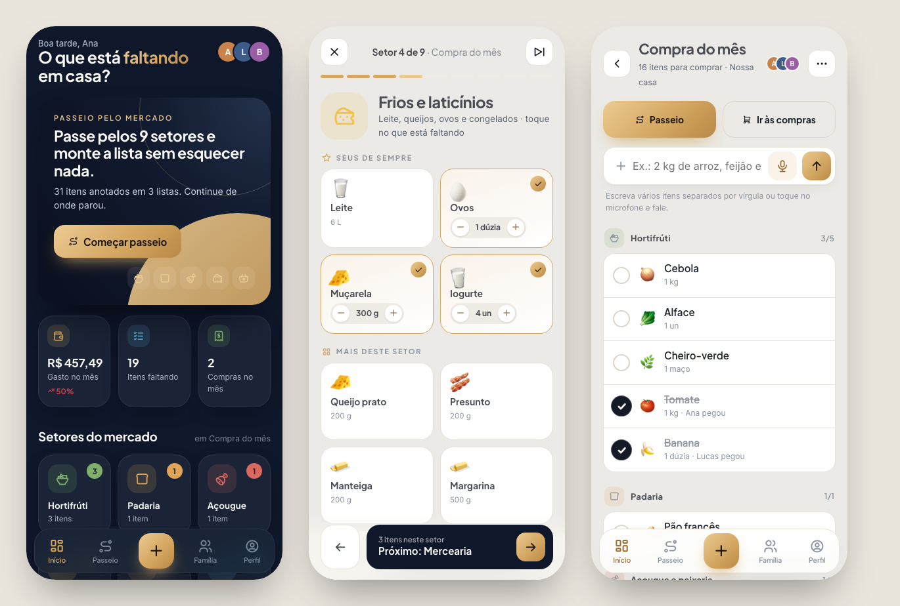

# mercato

**Compras organizadas. Vida mais leve.**

O Mercato é uma lista de compras compartilhada com a família, organizada pelos setores do mercado. Em vez de uma caixa de texto em branco, o app conduz um **passeio pelo mercado**: você passa por cada setor (Hortifrúti, Padaria, Açougue…) e toca no que está faltando. Assim, nada fica para trás.




## O que o app faz

- **Painel**: gasto no mês, itens faltando, setores do mercado com contagem, listas e gráfico de gastos por semana.
- **Passeio pelo mercado**: 9 setores na ordem de um mercado, com os "seus de sempre" no topo e mais de 130 itens prontos para tocar.
- **Escreva ou fale**: "2 kg de arroz, feijão e três latas de milho" vira 3 itens, cada um no setor certo, com a quantidade certa.
- **Modo compra**: marque o que foi para o carrinho, anote o preço e acompanhe o total e o progresso em tempo real.
- **Família**: todos na mesma lista. Quem pega um item aparece para os outros na hora.
- **Tema claro e escuro**, app instalável (iPhone, Mac e Android) e funcionamento offline.

## Modo demonstração

Abra o app com `?demo` no endereço para ver uma família de exemplo (Ana, Lucas e Bia) com listas, compras e histórico fictícios:

```
https://SEU-ENDERECO/?demo
```

## Tecnologia

- HTML, CSS e JavaScript puros (módulos ES), sem etapa de build
- PWA: `manifest.webmanifest` + `sw.js` (offline)
- Fontes: Plus Jakarta Sans, Inter e Outfit · ícones Tabler
- Supabase: login por e-mail e senha, casa da família com convite, tempo real e RLS por família
- Offline primeiro: tudo é salvo no aparelho e sincroniza quando a internet volta

## Configurar a nuvem (Supabase)

1. Crie um projeto no Supabase e rode `supabase/schema.sql` no SQL Editor (tabelas, RLS por família, funções e tempo real).
2. Em `js/config.js`, preencha a URL do projeto e a chave **publishable**. Nunca use a chave secret/service_role no front.
3. Sem configuração, o app funciona só no aparelho e no modo demonstração.

## Rodar localmente

```bash
python3 -m http.server 8080
```

Depois abra `http://localhost:8080/?demo`.

## Estrutura

```
index.html            casca do app
css/app.css           identidade visual, temas e animações
js/app.js             telas e navegação
js/store.js           dados (salvos no aparelho)
js/nuvem.js           Supabase: conta, casa, fila offline e tempo real
js/config.js          URL e chave publishable do Supabase
supabase/schema.sql   banco de dados
js/catalogo.js        setores, itens e leitura de texto/voz
icons/                logo e ícones do app
marca/                proposta de marca
prints/               imagens para o portfólio
```

---

Projeto de [Leão Design](https://github.com/landerleao) · design e programação.
